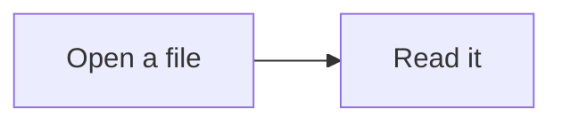

# Glance help

Glance is a local Markdown reader. It opens one file at a time, or a folder with
a browsable tree, and renders the document without sending it anywhere.

## Open something

- Use **File > Open File...** (`Ctrl/Cmd+O`) to pick one or more Markdown files.
- Use **File > Open Folder...** (`Ctrl/Cmd+Shift+E`) to open a project folder.
- Drag a file or folder anywhere onto the window.
- On Windows, right-click a Markdown file and choose **Open with Glance**, or
  drop a file or folder onto the Glance icon. If Glance is already open, the
  path opens in the existing window.
- Click a file in the sidebar, or follow a relative link inside a document.

When a folder opens, its root `README.md` is shown automatically if it has one.
The sidebar lists the folder's Markdown and text files. Folders with no README
open with an empty reading pane until you choose a file.

## Move around

- The sidebar holds the folder tree, or the files opened during this session.
  Use the `x` on an opened file to close it from the session without closing the
  window. While **View > Reopen Last Folder** is on, Glance remembers the last
  document and opened files for the next launch.
- **View > Back** and **View > Forward** move through the documents opened in
  this session.
- The contents rail follows the headings in the open document. Click an entry
  to jump to it. Use **View > Table of Contents** or `Ctrl/Cmd+Shift+O` to turn
  the rail on and off.
- **View > Switch to File** (`Ctrl/Cmd+1` through `Ctrl/Cmd+9`) opens the nth
  file in the sidebar. The most recently opened files come first.

## Find and search

- `Ctrl/Cmd+F` finds text in the open document. Press `Enter` for the next
  match and `Shift+Enter` for the previous one. `Aa` matches case.
- `Ctrl/Cmd+Shift+F` searches the open folder, or the files opened this session
  when no folder is open. Click a result to open it at the matching line.

## Appearance

- `Ctrl/Cmd+T` switches between the light and dark themes. The first launch
  follows the operating system; after that, Glance remembers your choice.
- `Ctrl/Cmd+B` hides or shows the sidebar.
- `Ctrl/Cmd+=`, `Ctrl/Cmd+-`, and `Ctrl/Cmd+0` zoom in, zoom out, and return to
  actual size.
- `F11` toggles full screen.

## Live reload

When **View > Live Reload** is on, Glance watches the open file and redraws it
after each save. Scroll position is kept when it still makes sense. The tree
also refreshes when files are added, renamed, or removed in an open folder.
Turn live reload off in the View menu if you prefer to refresh manually with
`Ctrl/Cmd+R`.

## Rendering

Glance handles standard Markdown plus the GitHub-style features below.

### Code

Fenced code blocks are syntax highlighted. Hover a block, or press `Tab` until
its **copy** control is focused, then press `Enter` to copy the original source.
The control briefly changes to **copied**.

### Mermaid diagrams

Use a fenced block marked `mermaid`:

Diagrams render locally and follow the light or dark theme. Wide diagrams
scroll inside their block. If a diagram cannot be rendered, Glance leaves the
original Mermaid source visible with a quiet notice instead of breaking the
page. Mermaid blocks do not get a copy control.

### Math

Inline math uses `$...$` and display math uses `$$...$$`. Currency such as
`$5 and $10` stays ordinary text. Invalid expressions remain visible in a muted
monospace style, and long display equations scroll horizontally.

### Alerts

Start a blockquote with one of GitHub's alert markers:

- `[!NOTE]`
- `[!TIP]`
- `[!IMPORTANT]`
- `[!WARNING]`
- `[!CAUTION]`

The marker becomes a small lowercase label beside the quote. A blockquote
without a marker remains a normal quote.

### Footnotes

Write a reference with `[^1]` and define it later with `[^1]: The note.` The
same convention works for IDs such as `[^setup]`. Clicking a reference jumps to
the note, and the **back** link returns to the reference.

### Emoji

Emoji shortcodes such as `:warning:`, `:rocket:`, and `:sparkles:` render as
Unicode characters. Shortcodes inside code blocks are left alone.

## Images and links

Relative images are read from the open file's folder and displayed in the
document. A leading slash starts at the folder root. Images outside the opened
folder are not served.

Relative Markdown links open other documents in the app when they stay inside
the open folder. Web links open in your default browser. Other files are handed
to their usual desktop application.

## Supported files

Glance opens `.md`, `.markdown`, `.mdown`, and `.txt` files. The Windows
installer registers the three Markdown extensions for **Open with Glance**;
`.txt` files can still be opened from inside the app. A single file's folder
becomes the boundary for its relative images and links; a folder stays the
boundary while it is open.

## Keyboard shortcuts

| Action | Shortcut |
|---|---|
| Open file | `Ctrl/Cmd+O` |
| Open folder | `Ctrl/Cmd+Shift+E` |
| Find in document | `Ctrl/Cmd+F` |
| Search files | `Ctrl/Cmd+Shift+F` |
| Back / forward | `Alt+Left` / `Alt+Right` (macOS: `Cmd+[` / `Cmd+]`) |
| Toggle sidebar | `Ctrl/Cmd+B` |
| Toggle theme | `Ctrl/Cmd+T` |
| Toggle contents | `Ctrl/Cmd+Shift+O` |
| Toggle live reload | `Ctrl/Cmd+Shift+L` |
| Switch to the nth file | `Ctrl/Cmd+1` through `Ctrl/Cmd+9` |
| Zoom in / out / reset | `Ctrl/Cmd+=` / `Ctrl/Cmd+-` / `Ctrl/Cmd+0` |
| Reload the app | `Ctrl/Cmd+R` |
| Full screen | `F11` |
| Help | `F1` |

## Troubleshooting

- **A diagram shows its source instead of drawing.** The Mermaid syntax is
  invalid or uses something the strict renderer cannot draw. The notice names
  the fallback; fix the source and save.
- **Math appears muted instead of rendered.** The expression is invalid, or it
  uses a command Glance does not allow. Currency is not treated as math.
- **A relative image or link does not open.** It points outside the open folder
  or the file no longer exists. Reopen the containing folder and try again.
- **The document did not update after a save.** Check that **View > Live
  Reload** is on, then use `Ctrl/Cmd+R` once.
- **The folder tree is stale.** It refreshes after a short delay when files
  change. Use **File > Open Folder...** again if a network drive did not report
  the change.
- **Open with Glance is missing.** Reinstall a Windows build from 0.1.3 or
  later; development launches do not register file associations. Windows can
  still ask which app to use the first time, so choose Glance there.
- **Open with lists Electron instead of Glance.** Reinstall the 0.1.3 Windows
  build. It writes Glance into the executable's product metadata and removes the
  old `electron.exe` entry left by development launches.

## Privacy

Glance reads local files only. Rendered HTML is sanitized, external links are
handed to your browser, and the app does not fetch remote assets. Mermaid,
KaTeX, fonts, and the other rendering libraries are bundled with the app.
